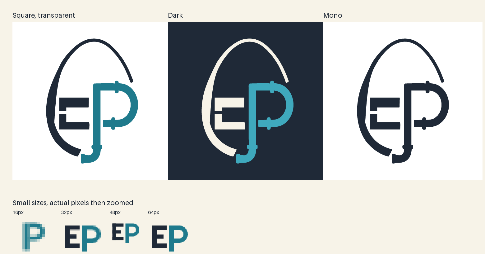
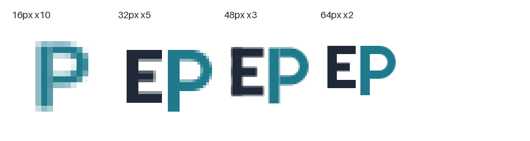
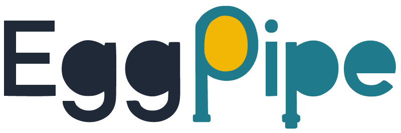
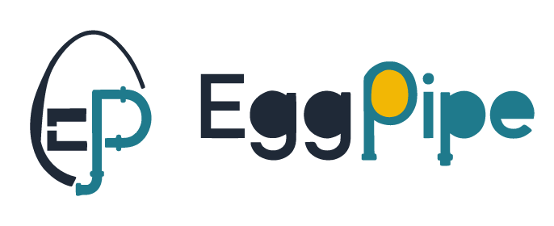

# Brand assets

Иконка и изображения Eggpipe. Исходная концепция — [logo-brief](../../engineering/decisions/logo-brief.md).

## Структура

```text
docs/assets/brand/
├── svg/                         # векторные мастера
├── png/                         # экспорты для документации и приложений
├── lockup/                      # wordmark и lockup, SVG + PNG light/dark
├── social/                      # GitHub social preview
├── favicon.ico
├── preview.png
├── preview-small-sizes.png
└── README.md
```

## Preview









## Где используется

| Место | Файл |
|-------|------|
| MkDocs, логотип в сайдбаре | `png/eggpipe-icon-128.png` |
| MkDocs, favicon | `favicon.ico` → копия в `docs/img/favicon.ico` |
| README, светлая тема | `lockup/eggpipe-wordmark-light.png` |
| README, тёмная тема | `lockup/eggpipe-wordmark-dark.png` |
| `docs/index.md` | `lockup/eggpipe-wordmark-light.png` и dark-вариант |
| Lockup с иконкой | `lockup/eggpipe-lockup-light.png`, `lockup/eggpipe-lockup-dark.png` |
| GitHub social preview | `social/eggpipe-social-1280x640.png` |
| GitHub avatar | `png/eggpipe-icon-512.png` |
| PyPI README | те же PNG по абсолютным URL после появления репозитория |
| Android / PWA | `png/android-chrome-192x192.png`, `png/android-chrome-512x512.png` |
| Apple touch icon | `png/apple-touch-icon.png` |

## Размеры

| Размер | Версия |
|--------|--------|
| 16px | упрощённый `P` |
| 32–64px | упрощённый `EP` без яйца и фланцев |
| 128px+ | детальный знак с яйцом, `EP` и трубой |

Квадратные версии сохраняют исходные пропорции: знак не сжимается по вертикали,
свободное место добавляется по бокам.

## Варианты

- `eggpipe-icon.svg` — мастер 511:665;
- `eggpipe-icon-original.svg` — 787:1024;
- `eggpipe-icon-square.svg` — квадрат 1024;
- `eggpipe-icon-dark.svg` — eggshell вместо slate, teal `#3FA9BD`;
- `eggpipe-icon-mono.svg` — один цвет slate;
- `eggpipe-icon-mono-light.svg` — один цвет eggshell.

## Lockup

Векторные мастера:

- `lockup/eggpipe-wordmark.svg` — wordmark;
- `lockup/eggpipe-wordmark-dark.svg` — wordmark для тёмного фона;
- `lockup/eggpipe-lockup.svg` — иконка + wordmark;
- `lockup/eggpipe-lockup-dark.svg` — lockup для тёмного фона.

PNG-экспорты:

- `lockup/eggpipe-wordmark-light.png`, `lockup/eggpipe-wordmark-dark.png`;
- `lockup/eggpipe-lockup-light.png`, `lockup/eggpipe-lockup-dark.png`.

## Ограничения

- SVG иконки и wordmark получены автотрассировкой исходных PNG. Перед публичным
  релизом желательно перерисовать кривые вручную в Figma/Inkscape.
- `social/eggpipe-social-1280x640.png` собран из векторного lockup; tagline в нём
  пока растровый.
- `apple-touch-icon.png` — единственный PNG с фоном, так требует iOS.

## Пересборка

Исходный скрипт сборки и промежуточные файлы лежат в `.local/logo-build/` (не коммитится).
После изменения SVG можно пересобрать PNG тем же скриптом и скопировать результат сюда.
