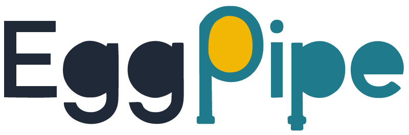

# Eggpipe

  <picture>
    <source media="(prefers-color-scheme: dark)" srcset="assets/brand/lockup/eggpipe-wordmark-dark.png">
    
  </picture>

> **Статус: beta (0.x).** Проект находится в стадии бета-тестирования. До версии 1.0
> публичный API, CLI, формат `.eggpipe.yaml`, JSON-отчёт и генерируемые артефакты могут
> меняться без сохранения обратной совместимости. Для production фиксируйте версию и
> читайте `CHANGELOG.md`. Подробнее — [Статус и совместимость](user/status.md).

Документация проекта `eggpipe` — генерация артефактов из YAML-описания модели данных.

## Разделы

### Для пользователей

- [Быстрый старт](user/quickstart.md) — установка, модель, конфиг и первый запуск.
- [Плагины](user/plugins.md) — как писать генераторы и форматы.
- [Диагностики](user/reference/diagnostics.md) — коды EGxxx и что делать.
- [Каталог пользовательской документации](user/index.md).

### Для AI-агентов

- [AI documentation](ai/index.md) — точка входа.
- [AI context](ai/context.md) — компактный контекст проекта, API и команды.
- [AI tasks](ai/tasks.md) — типовые задачи и последовательности действий.
- [AI invariants](ai/invariants.md) — что нельзя делать.
- [llms.txt](ai/llms.txt) — индекс для LLM.
- [llms-full.txt](ai/llms-full.txt) — полный контекст.
- [manifest.json](ai/manifest.json) и [schemas](ai/schemas/model.schema.json).

### Для разработки

Инженерная документация (ТЗ, ADR, System Design, ревью, план и релиз) находится
в каталоге [`engineering/`](https://github.com/SpiGit/eggpipe/tree/main/engineering) репозитория и не входит в сайт документации.
